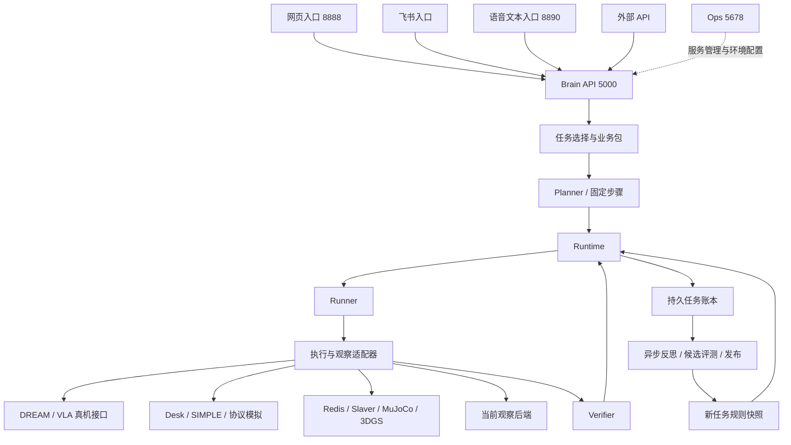

# 架构设计：系统架构与演进

更新日期：2026-10-20。范围为 Connection 大脑、独立入口、执行后端与学习模块的职责、设计理由和后续演进。当前结构按本仓库代码核对，现场通过范围按带日期的联调证据引用；本文不代表重新验收真机或改变部署配置。

本文合并原三端架构、重构前后对比和重构规划，作为唯一架构与演进主文档。接口字段、操作步骤在对应接口说明维护；验证结论、问题闭环与待验证项在对应模块的多端联调持续更新，日期标在正文。已过时的实施步骤、临时目录和迁移过程保留在 Git 历史，不再作为当前运行指南。

## 1. 当前架构

### 1.1 系统职责与调用方向

Connection 是任务级大脑，不直接控制电机。Runtime 是任务状态唯一权威；Planner 生成计划，业务包定义固定流程，Runner 执行既定步骤，Verifier 核验证据。

| 模块或端 | 负责 | 边界 |
| --- | --- | --- |
| 网页、飞书、语音文本入口 | 接收输入、必要确认、转发与展示 | 各自直连大脑，不持有另一份业务任务账本 |
| Brain 应用层 | 组装模块、工作器生命周期、API 与快照 | 一个大脑进程管理有界后台工作器；慢模型和执行调用不应阻塞控制请求 |
| Runtime | 任务、步骤、尝试、状态、恢复与事实落账 | 只读状态查询不推进任务；旧任务迟到结果不能覆盖新任务 |
| Planner / 业务包 | 能力约束内规划；定义固定 SOP | 模型不向固定接待流程注入坐标、跳步或额外动作 |
| Runner / 适配器 | 请求构造、提交、原命令查询、证据转换 | 不自主更换目标或路线，不把网络异常当作已停止 |
| Verifier | PASS / FAIL / UNKNOWN | 下游声称成功仍需身份、时间和效果证据；缺证据不能升级为成功 |
| DREAM | 定位、审核、路径规划、导航准入及执行终态 | 不自动调用 VLA；大脑不绕过导航安全链 |
| VLA | 抓放、策略停止、动作通路归还及操控证据 | 不决定下一段导航，不启动第二个 LowCmd 控制器 |
| NX / SONIC | 本体控制、输入采纳、本地保护 | 端口可用不等于本体已接管，物理保护不能由任务恢复解除 |
| Ops | 服务启停、健康、日志、运行环境 | 不发布接待任务，不充当第二个任务调度器 |
| learning | 反思、示教候选、评测、影子、发布与回滚 | 不在线改内核代码，不改变已经打开任务的规则快照 |

DREAM/VLA 使用 `fq/reception-lan/v1`。真机层常见导航端口 8001、VLA 8091、审核页 9882；实际地址来自 `config/networks.yaml` 当前网络和有效覆盖，不在架构文档维护第二张固定 IP 表。真机侧策略、relay、相机和控制器的详细操作见[控制面板](接口说明_控制面板.md)、[导航](接口说明_导航NAV.md)和[操控](接口说明_操控VLA.md)。

### 1.2 业务与执行后端

接待、通用任务、现场观察、桌面整理及历史演示共用 Runtime。明确登记触发词直接选业务；其他表述由 LLM 按登记范围选择。超范围需求应澄清或拒绝，不能静默套入固定 SOP。

单罐接待为版本化 `reception.single_can`：v1 保留原四段导航，v2 使用新坐标并在抓取后增加 relay1；抓放及 relay3 横移保持。准备、可选检查、核验和交接节点由同一编译器展开。模型不能改写路线。`reception.single_can.nav_only` 仅由明确触发词选择，从同版本定义派生所有导航；成功只表示仅导航测试完成。

接待顺序与参数由随包封存的 YAML Skill 定义提供，`packages/reception_skill.py` 负责读取、校验并编译
为现有 `StepSpec`，不新增执行循环、账本或状态机。参数、导航点与抓放凭证关联属于定义；
物体效果证据、交接和安全收尾要求由编译器与现有 Verifier 保证，定义不能关闭。
Skill schema 1 保持原四段精确校验，schema 2 校验可配置坐标、连续段序、动作引用及门段约束。
LAN 请求格式保持 v1，真实执行端仍独立核准路线。旧协议模拟保持原四段准入；SIMPLE 按服务声明的完整路线与任务快照比对，
新版 O6 新房子物理回合增加独立 relay1 到达段，并可配置仅导航模式；所选 SOP 必须与健康声明的路线及模式一致，
不兼容的新定义在端口创建前拒绝。仅导航删除物理抓放步骤，完整接待仍保留原持物约束。新增参数不等于新增操控能力或远端部署。

业务选择在模型调用前读取并校验定义，正式接待把定义和内容摘要绑定到原任务的 `selection`；
Planner 使用该快照展开步骤，Runtime 持久保存每步的导航参数与凭证来源。文件变化只影响后续新任务，
恢复沿用原步骤和原命令。旧账本的缺省字段仅兼容原固定 v1，不重读新定义改写旧任务。
格式、配置与预览入口统一见[接待 Skill 定义](接口说明_大脑%20Brain.md#111-接待-skill-定义与任务快照)。

`INITIALIZING`、`FETCHING_WORLD` 仍为本地节点。明确接待触发词在真机后端的 `/api/task_preflight`
只读核对导航接口与 Skill 定义，不占用 Runtime 状态写入线程，不创建任务或下发动作。
固定合同冲突在提交前指出；独立目标模式非强制的参考点位差异仅提示，业务流程仍归大脑。
预检不是定位批准、运动许可或三端能力验收，继续旧任务仍按原快照及实际派发门检查。
页面的请求等待与过期标记只描述通信，命令阶段和可复制总结均派生自 Runtime 账本，不另建任务状态机。
具体字段、范围与边界见[大脑接口](接口说明_大脑%20Brain.md#81-流程与请求身份)。

| 后端 | 当前用途与限制 |
| --- | --- |
| 真机接待 | 大脑直连 DREAM / VLA；由实际派发许可和下游闸门决定准入，不能写死“当前始终关闭” |
| `reception_mock` | 历史接待演示，标记 `reception.demo`；不等于正式单罐 HTTP 接待 |
| `reception_protocol` | 独立 NAV/VLA 协议模拟，覆盖合同、异常和控制流程；不是物理运动证明 |
| `reception_simple` | SIMPLE O6 连续 MuJoCo 回合，复用接待客户端与核验；执行器可选旧房间或新办公室，验收按场景分别记录 |
| Desk | 通用抓放和整理的抽象状态后端，直接 HTTP，无实时相机 |
| `simple_o7` | SIMPLE O6 通用单步抓取，与 `reception_simple` 的连续接待能力区分 |
| MuJoCo / 3DGS | 既有通用工具路径继续经 Redis / Slaver；各自的运动与抓放真实性边界见联调记录 |
| 现场观察 | 使用显式选择的观察后端，不生成身体命令，不在后端不可用时自动换另一台相机 |

运行环境由全局模式加接待、通用执行、观察模块覆盖组成。草稿在 `config/execution.yaml`，生效快照在 `data/system/execution.json`；新任务绑定执行身份与环境版本，恢复附着原后端。切换需经过准入检查、健康核查、应用及失败回退，不能通过删除任务账本清除阻塞。未接入的通用真机能力明确不可用，不回落仿真。

混合接待变体绑定 `reception_real_sim_manipulation` 后端，从同一 Skill 快照展开完整流程，
由专用 BodyAdapter 组合真实导航客户端与本地操控模拟客户端。模拟端复用既有操控结果轮询与 Verifier，
只模拟抓放命令和结果，不新增任务调度循环或持久任务账本，不连接 VLA 或切换实体控制权。
已核验的模拟终态从 Runtime 账本恢复；缺失回执仍为 UNKNOWN。任务、节点、原始回执及交接记录明确标注模拟范围，
模拟持物状态不作为真实世界物体事实。边界和操作见[当前接待流程](接口说明_大脑%20Brain.md#81-流程与请求身份)。

同一模拟操控组件可与原导航项目的隔离 O6 仿真组合，使用独立
`reception_ros_sim_manipulation` 任务身份；准入校验要求原 ROS 桥接场景声明和匹配路线，
不与固定路点执行器或真机模式混用。

### 1.3 工程与数据归属

SIMPLE 新办公室接入沿用远端 HTTP 服务、命令账本及每任务一个物理回合的结构。
场景选择发生在远端执行器内部，由办公室布局映射和动作描述适配到同一 Episode；大脑仍逐段派发和核验。
办公室资产保留独立快照，派生碰撞布局同时供物理与抓放规划使用；导航复用 O6 SONIC 的目标反馈控制，
不并行启动办公室演示的 ROS 自动任务循环。实际场景、资产哈希和校准物体差异写入执行证据，
接口及使用方式见 [SIMPLE 仿真接口](接口说明_simple%20o6%20仿真.md#新办公室场景office_v2)。

ROS 新办公室仅导航实验另由 `simulation/backends/ros_navigation/` 适配现有 8001 导航服务，
场景坐标在执行入口映射，原 8001 保持命令权威，大脑 Runtime 保持任务权威。
复用现有物理仿真路由及标准 Brain 应用，以独立配置、账本、无网络容器和 UNIX socket 隔离实验；
不新增接待调度循环，不提供操控动作。其导航实现为 g1pilot，区别于上述 O6 路点执行器。
能力边界见[导航接口](接口说明_导航NAV.md#新办公室-ros-仿真接入2026-10-10)。

同日 GR00T 联调另外使用实验专用 pick 任务适配，将同事集成的文件触发推理接入现有大脑提交／查询合同；
任务状态仍由 Runtime 管理，物理效果失败不改写为成功。该适配未部署到主服务，place 入口尚未核实，
不改变上述仅导航后端的能力声明。实际边界见
[GR00T 实验接口口径](接口说明_操控VLA.md#新办公室-gr00t-仿真实验2026-10-10)。
后续调用演示仍复用 Runtime 的显式跳过：不支持的 place 请求只保留失败事务，不生成物理效果，
含跳过的流程结束仍为失败；实验适配不因此成为完整抓放后端。

| 路径 | 维护内容 |
| --- | --- |
| `src/brain/app.py`、`application.py`、`workers.py` | 应用组装、统一生命周期、有界作业与控制 |
| `src/brain/kernel/` | Planner、Runtime、Runner、Verifier 与短时记忆 |
| `src/brain/packages/`、`skills/` | 业务包、固定流程、能力目录 |
| `src/brain/adapters/` | 模型、DREAM、VLA、Desk、Slaver、SIMPLE 与观察适配 |
| `src/brain/learning/` | 反思、示教、经验、评测、发布与回滚 |
| `src/brain/storage/`、`observability/`、`api/` | 持久账本、事件与统一 HTTP API |
| `src/entries/`、`clients/`、`contracts/` | 独立入口、共用客户端与合同 |
| `src/ops/`、`src/shared/` | 运维、配置、地址、日志与环境事务 |
| `src/execution/`、`simulation/` | 按需执行底座、仿真后端与独立服务 |
| `config/` | 配置模板、本机配置、业务规则与静态场景 |
| `data/tasks/` | 当前 Runtime 任务账本与事件；每步保存尝试和原命令 |
| `data/memory/`、`data/business/` | 经验、反思、示教及现场资料 |
| `data/timelines/`、`data/experiments/` | 回放与独立实验记录 |
| `data/retired/` | 历史数据，只读保存，不作为当前任务恢复入口 |
| `logs/` | 按日期和服务保存的过程日志与诊断 |

源码根为 `src`，不是 Python 包名；不存在正常运行用的 `src/connection` 兼容层。启动使用 `python -m brain`、`entries.web`、`entries.feishu`、`entries.voice`、`ops`。依赖安装与启动命令集中在[项目 README](../README.md)，运行步骤集中在[控制面板](接口说明_控制面板.md#三端启动与任务发布)。

代码与公开模板通过 Git 在服务器间同步；本机网络、凭据、环境选择和运行数据独立保留。
`config/business/` 保存基础 SOP，生成结果写入 `data/business/`，展示端从同一运行数据位置读取；
展示不会发布规则或改变任务快照。配置初始化与首次升级保护步骤见[配置说明](../config/README.md#多服务器代码同步)。

任务存储沿用文件账本、目录互斥、版本检查和原子写入，不因旧规划提到 SQLite 就更换大脑存储；远端执行器可以独立使用 SQLite。旧 `ReceptionStore` 的相位文件不是另一份当前状态权威。迁移要保存来源和校验值，不把历史成功标签改名后强行续跑；工程迁移映射见 `tests/contracts/e6_file_map.json`、`tests/contracts/retired_test_coverage.json`。

## 2. 核心机制与设计理由

### 2.1 任务、命令与恢复

任务表示整轮目标，步骤表示流程中的环节，尝试记录一次执行，`command_id` 标识下游事务。保留这几个层级是为了区分“查询旧动作”和“再做一次动作”，避免超时、丢回包或重启造成重复抓放。

- 查询必须使用原命令；404、HTTP 500、连接断开本身均不能证明动作未执行。
- 可识别的提交拒绝与不确定提交分开保存；原命令已成功时先核验，不能因为用户点继续就重复动作。
- 新尝试须按当前控制规则确认原动作未开始或已结束，并保留旧请求和失败记录；重试用新的命令号。
- 暂停保留流程并请求停止当前动作；继续核查当前环节；跳过保留人工放弃记录。含跳过的流程结束不记全部成功。
- 跳过的停止证据区分已创建的执行命令与明确提交拒绝。后者复用原始、身份匹配的拒绝回执；仍核查此前实际命令，不将“请求已发出”当成“下游已创建动作”。
- **取消任务只结束大脑编排与本地等待，不调用导航或操控取消接口，不声明本体已停。** 导航重启及现场停止独立处理。进程退出也不是物理停止证明。
- 取消关闭派发并隔离旧作业结果，避免迟到规划、执行或反思污染新任务。只读查询不增加重试次数。

此处解释机制，接口参数、可操作状态和详细判据以[大脑控制接口](接口说明_大脑%20Brain.md#12-任务控制接口)为唯一维护点。

### 2.2 核验与跨端交接

效果达成、原策略停止、动作出口归还、本体采纳新控制源是四件不同的事。手闭合不等于抓住物体，TCP 端口空闲不等于 NX 已接管。Verifier 检查身份、带时区时间、效果及停止证据；`hand_state_only` 不能让物体抓放通过。

Desk 的通用计划在任何动作派发前逐项核对单动作语义，拒绝把抓取、放置合并的步骤截断为其中一个动作。
这防止“某一步效果通过”被错误地用于表示模型原计划中遗漏的动作也已完成；规则与复验见
[大脑接口](接口说明_大脑%20Brain.md#11-共用任务选择与异常建议)和 [Qwen 本地测评](多端联调_模型接入与评测.md#e-m2)。

当前大脑普通交接先查询原命令、导航和操控状态；无控制器凭证时，可以按原命令成功且已停、资源已释放、两侧无活动命令及通路就绪放行，记录 `transport_ready_without_receipt`。如果下游返回凭证，仍核查身份与有效期。跨越人工跳过的交接有显式例外，记录 `manual_skip`，不把原失败命令伪造成成功，下一端仍可按自身前置条件拒绝。具体实现与最终收尾见[大脑交接规则](接口说明_大脑%20Brain.md#83-控制交接与人工跳过)。

这些联调放行规则不等于真实控制器接管协议已经验收。不得将现有通路证据写成来源、代次、控制器实例均已被本体确认。5556 单发布者、现场定位批准、操控批准及本体保护继续属于对应端职责。

### 2.3 记忆、模型建议与学习

短时窗口只裁剪读取视图，默认最近 20 条、30 分钟；不删除事件账本或未核清命令。PASS 建立的进展保留来源，不随短时窗口过期；其他观测须带来源、观测时间和有效期。过期观测降为线索，冲突保留双方证据，不能拼成确定位置。实现见 `kernel/memory.py`。

模型参与通用规划、范围受限的业务选择及异常建议。异常建议绑定原任务、命令与账本版本，`automatic=false`；迟到或无效建议不能执行控制，格式非法时回退规则建议。默认网页显示中文原因与原始英文错误；当前版本可按配置展示建议并确认一次受限操作，详见第 3.1 节。LLM 分析不作为确定根因；API 保留 `recovery_advice`。

正式大脑的入口分流／闲聊及后台反思也使用大脑主模型配置，避免更换规划模型后仍隐式依赖旧服务。
视觉核验保持独立模型配置。供应商切换不改变 Runtime 权威、已绑定计划或执行合同；字段与生效方式见大脑接口说明。

2026-10-20 本地图片后端接入补齐：视觉适配器共享请求选项构造，端点仍由既有的
`camera.vlm` 与 `reception_real.verification.vlm` 分别维护，不增加第二套配置来源。
图片模型与文字裁决继续分开，免鉴权须显式配置；异常或无有效视觉结论不得冒充正常。
共享选项层不持有任务状态、不下发动作，实际切换及尚未验证范围见
[本地图像 API 替换](多端联调_模型接入与评测.md#e-m6)。

反思读取执行快照，在在线执行闭环之外生成经验。保存反思文件不等于经验已生效：可归因的失败模板进入候选，经过离线评测和不派发动作的影子验证，才允许发布。单次首次成功、人工完成或同一步重试不能冒充自主改进证据。发布合并原活动规则并保留 `parent_id`，回滚沿父版本；新任务绑定快照，旧任务不随发布变化。

当前实现是有限规则和场景的学习切片，不代表通用自主学习、自动修代码或自动物理重试。相关代码为 `learning/reflection.py`、`releases.py` 和 `kernel/verifier.py`；示教保存也只进入候选。后台反思是否启用由配置和任务设置决定，不用文件是否存在推断本轮实际收益。

### 2.4 为什么保持这些工程边界

独立入口便于故障隔离，网页关闭后大脑仍可处理已接受任务；核心使用一个进程及受管理工作器，避免多个服务争写同一任务。Redis 只为仍依赖它的 Slaver 路径保留，不能为了统一目录删除执行底座，也不需要为此新增消息总线或工作流平台。

接口、账本与实际动作以任务和命令关联。日志是诊断证据，不是状态权威；查询和监测不自动推进任务。后端可替换，但不能通过降低核验标准“统一”真机与仿真。每次环境切换、部署和恢复都需区分进程在线、协议可用和物理动作通过。

## 3. 后续演进

以下为尚待完成或扩大的范围，不是新增 API 承诺，不因架构文档合并自动实施。每项先明确合同与验收，再更新接口和真实联调证据。

| 方向 | 当前边界 | 下一步与完成标准 |
| --- | --- | --- |
| 接待新流程与受限参数理解 | 原流程封存；新版五点定义已支持编译和任务快照，抓放不变；未新增 LLM 参数理解 | 待 NAV 接入新版五段并复验真实执行；再考虑 LLM 受限参数理解，模型不能自行修改路线 |
| LLM 异常建议的人工确认闭环 | 已实现建议展示、确认与执行关联；公开模板默认关闭，本机已启用 | 具体范围和验收见下方第 3.1 节；隔离回归与 O6 导航物理复验已完成；正式项目 O6 导航复验 7/7，已启用并回切真机；真机动作及异常恢复待联调 |
| 完整任务前检查 | 已实现真机导航接口与点位声明的只读预检；尚未覆盖完整定位、运动与操控就绪 | 扩展实时就绪检查、结果时效与错误出口；服务不可达及条件变化不能误放行，接口与现场负例均验证 |
| 真机完整接待 | 已有仅导航多轮证据；完整 NAV + VLA + 本体闭环未由这些结果证明 | 完整跑通抓取、持物导航、放置和收尾，保留物体效果、停止、控制归属及每步原命令 |
| 控制器接管协议 | 当前无凭证可按通路就绪放行；这不是本体采纳证明 | 对齐真实源/目标、任务/命令、控制器实例/代次和有效期；覆盖迟到回包、重启、新 STOP 使旧凭证失效等负例 |
| 跨重启恢复与独立诊断 | 能保存账本和查询原命令；远端持久化及物理世界恢复能力不统一 | 先建立只读恢复诊断合同，再验证各端重启、丢回包和旧命令未知；不得通过新 ID 掩盖重复执行 |
| Slaver 在线控制 | 旧路径缺统一持久命令查询与在线停止证据 | 补齐命令身份、查询、停止和重启后核查；再证明可安全暂停和继续 |
| 仿真能力拓展 | SIMPLE 固定 O6 场景通过；3DGS 完整抓放缺验收 | 按场景、物体、种子记录成功失败；补齐物理效果和状态连续性，不把协议成功当物理成功 |
| 在线视觉与场景更新 | 部分后端无相机，物体效果主要来自各端回包 | 保证图像来源、时间与命令一致；跨任务和跨后端图像不能复用为证据 |
| 语音、求助与多机 | 已有已识别文本入口；完整语音业务、求助执行、多机调度未齐 | 分别定义能力、任务归属与完成标准；多机明确各任务和资源权威，不增加平行状态源 |
| 学习收益 | 候选、评测、影子、发布/回滚已有切片 | 用独立任务验证收益及回归，不以反思条数衡量；保持旧任务快照、可追溯和可回滚 |

增加能力时先检查现有业务包、适配器和接口是否能承接；只有职责改变才修改整体架构。未实现项明确写“待实施”，有代码但未做现场实验写“待验证”，不能混用。

### 3.1 第二阶段：LLM 异常建议与人工确认（已实现）

2026-10-12 确定本阶段目标：固定接待 SOP 正常运行；出现异常或等待人工时，LLM 根据原任务证据提出受限建议，
网页展示依据，用户确认后由同一个 Runtime 执行并核验。确认仅授权本次操作，不自动改 Skill、提示词或长期规则。
本阶段先在独立 worktree 实现与验证，随后按用户授权应用到真实项目并启用。公开模板默认关闭 `brain.reasoning.confirm_recovery_advice`；本机开关与已运行版本的证据见本轮联调。

**现有基础与缺口。** `brain/reasoning.py` 已按允许动作产生建议；`service.py` 在流程阻塞后发起分析；
`kernel/runtime.py` 保存 `recovery_advice`，并丢弃过期模型结果。现有状态接口提供建议和 `applicable`。
本阶段补齐网页呈现、确认身份与一次授权的记录，以及建议操作到原 Runtime 控制的连接；不另建决策服务或任务账本。

**本阶段范围。** 先覆盖接待及仅导航变体的 `waiting_human`、`recovery_required` 和需要分析的暂停状态。
正常成功节点仍按冻结的 Skill 推进；明确暂停、继续、跳过、取消保持现有入口与语义，暂停不等待模型。
本阶段不包含自然语言重新绑定取放参数、多流程组合、观察能力扩展、自动重试或自动固化处理经验。
这些属于后续独立验收项，不因模型提出建议而视为已经接入。

建议的动作边界如下；已实现的确认 API 与配置见[大脑接口](接口说明_大脑%20Brain.md#112-异常建议的人工确认)：

| 建议 | 用户看到的操作 | 允许产生的效果 |
| --- | --- | --- |
| `query_original` | 查询原命令结果 | 只查询并记录原命令证据；不生成新尝试、不自动派发下一步。确认完成后仍经核验，后续推进需另行确认 |
| `continue` | 继续当前环节（可能重试） | 复用现有继续语义，重查原命令、停止与资源；原动作已成功则核验，确认未完成才允许新尝试，前置条件仍生效 |
| `cancel` | 结束本轮任务 | 复用任务取消，只结束大脑编排；明确不等于机器人停止 |
| `wait` / `request_help` | 等待／查看人工处理说明 | 展示和记录处理意见，不伪造动作回执，也不自动联系外部人员 |

不把跳过、改坐标、改路线、任意工具调用加入模型可选动作。既有人工跳过按钮独立保留。
`Runtime.requery()` 可能更新任务状态，因此建议查询使用 `query_advice_original()` 只保存同一原命令的证据，
不调用 `continue_current()` 或核验推进。模型只能从程序根据当前证据计算的动作集合中选择。

**已实现路径与约束。**

1. 完成服务端建议合同与确认约束。扩展现有建议记录，关联建议身份、任务、控制步骤、尝试、原命令、
   账本版本和执行环境；程序提供可引用的事实摘要，模型输出建议及理由。模型超时、格式错误或越权时，
   明确显示规则回退来源，不能冒充 LLM 判断。
2. 在现有 Brain 应用层和 Runtime 上增加建议确认能力。客户端只提交建议身份与其所见任务上下文，
   不提交任意执行参数。服务端在现有任务串行化和互斥机制内检查建议仍适用，并持久化本次确认。
   任务或命令变更、建议失效、重复点击、确认与取消并发都不能重复派发；确认后崩溃或断网也不能重放动作。
   原有命令查询与新尝试身份继续保留，外层建议确认不能绕过下游停止及资源核查。
3. 网页增加“异常处理建议”区域，展示当前环节、已确认事实与未知项、LLM 建议和理由、具体操作按钮、
   处理回执及核验结果。区分建议生成中、待确认、已失效、处理中、被拒绝和处理完成；点击受理不能显示为动作成功。
   刷新页面只读状态；过期建议不可执行，服务端仍作最终校验。模型文字按纯文本展示。
4. 隔离测试覆盖身份、并发、迟到结果、规则回退和网页展示；接口说明维护当前能力；应用和环境切换单独记录。

建议确认记录作为原 Runtime 账本／事件的补充，关联到由既有控制逻辑创建的尝试和最终结果；
不以网页按钮状态、日志文字或 LLM 描述替代 Runtime 状态。正式应用的异常建议使用独立有界工作器，
不在 Runtime 所属线程同步等待，也不占用新任务规划工作器；继续／跳过后的驱动无需等待模型分析。
最多一个分析在执行和一个最新上下文待处理，结果以控制队列回到原 Runtime 进行任务、版本、状态和命令校验；
后台线程不写账本、不下发动作。关闭期间不投递迟到结果，重启不重放分析动作。
这是旁路分析的调度修正，不新增任务执行循环或状态权威。

**完成标准。**

- 导航失败且停止、资源已核清：产生受限建议；未确认时零新增命令，确认后最多授权一次继续处理，保留原失败。
- 回包超时、404 或停止未知：不推荐直接重发；查询保持原命令身份；查询得到成功后不能重新执行该动作。
- 旧建议、旧任务、旧步骤、迟到模型输出、双击、并发确认和暂停／取消：拒绝或返回同一处理回执，不误操作新任务。
- 模型不可用、越权输出及不可信回包内容：保留事实与错误，规则回退可识别；原有任务控制仍可用。
- 重启或确认响应丢失：不自动再次执行已批准的动作；核对原任务、命令和确认记录后再处理。
- 网页能完整追踪“证据 → 建议 → 人工确认 → 执行／拒绝 → 核验”，并明确只有本次授权，没有修改长期规则。
- 既有接待、仅导航、任务控制和迟到结果测试通过；完整离线回归使用 `venv/core/bin/python scripts/run_tests.py`。
  物理复验仍使用 SIMPLE O6 新房子，单独记录每次建议、确认、原命令和最终结果；离线假服务不冒充物理验收。

**验证状态。** 已完成隔离离线回归及 O6 新房子仅导航物理复验。真实模型本轮提出人工处理建议，
确认后由测试脚本模拟人工评估并选择既有继续操作，没有自主重试。
隔离验收后已应用真实项目，正式服务再次完成 O6 导航 7/7 并回切真机；实体动作仍待联调。详细计数、代理失败、模型输出、确认与核验边界见[隔离复验](多端联调_大脑任务与恢复.md#e-b4)与[正式项目应用复验](多端联调_大脑任务与恢复.md#e-b4)。

**实施与应用。** 开发阶段使用独立 worktree、配置和临时账本，未影响现场实例。隔离验收后，
按用户明确授权更新真实项目、启用功能并通过正式面板重启大脑／网页，切换到 SIMPLE O6 验证。
应用与回切须核对任务终态、下游命令及生效环境；源码修改和进程生效仍是不同事实。

## 4. 重要变更记录

| 日期 | 变化及原因 | 提交或证据 |
| --- | --- | --- |
| 2026-10-15 | 异常建议改为独立后台计算、原 Runtime 校验回写，修复模型超时阻塞人工继续／跳过后下发的问题；增加控制请求阶段日志及等待下发表达 | [故障与复验](多端联调_大脑任务与恢复.md#e-b5)、[当前接口](接口说明_大脑%20Brain.md#112-异常建议的人工确认) |
| 2026-10-15 | 主模型切换到千问；正式入口分流、闲聊和反思统一读取大脑模型配置，澄清接待约束与通用动作的选择边界 | [模型与 O6 验证](多端联调_模型接入与评测.md#e-m1) |
| 2026-10-15 | 跳过明确提交拒绝的操控步骤时使用原拒绝证据，避免查询不存在的命令；保留对此前实际动作的停止核查 | [现场问题与回归](多端联调_大脑任务与恢复.md#e-b6) |
| 2026-10-14 | 接待发布前只读核对导航接口与声明；面板增加查询时效、重试回执核对及账本摘要，保持 Runtime 唯一状态权威 | [任务控制与反馈](接口说明_大脑%20Brain.md)、[预检范围](接口说明_大脑%20Brain.md#81-流程与请求身份)；离线验证后经用户授权重启大脑与网页，健康与新增状态／总结字段核对通过，原失败任务和命令保留，未自动续跑；真机复验待进行 |
| 2026-10-12 | 接通受限异常建议展示和单次人工确认，保留原 Runtime 状态权威与查询／重试边界；隔离验证后经用户授权应用真实项目 | [确认接口](接口说明_大脑%20Brain.md#112-异常建议的人工确认)、[隔离复验](多端联调_大脑任务与恢复.md#e-b4) |
| 2026-10-12 | 新版五点接待采用 schema 2；O6 新房子支持显式仅导航并完成 7/7（一次导航重试）；保留原任务快照与模式／路线校验，未增加 LLM 能力 | [新版路线](接口说明_导航NAV.md#61-五点接待定义2026-10-12)、[复验记录](多端联调_大脑任务与恢复.md#e-b4) |
| 2026-10-12 | 现有接待抽取为版本化 YAML Skill，集中参数、点位、动作和凭证关联；模型选择与 Runtime 执行绑定同一快照，原合同和控制语义保持 | [定义与快照接口](接口说明_大脑%20Brain.md#111-接待-skill-定义与任务快照)、[本轮复验](多端联调_大脑任务与恢复.md#e-b4)；离线通过，物理复测因 CUDA 初始化失败受阻 |
| 2026-09-23 | 逐步引入 Runtime、来源与时效记忆、业务包和受限规则发布，避免不同业务各维护执行状态 | `4ae7667`、`5315c8b`、`5389d1a`、`debf3e5`、`d65a8f3`；各切片完成不代表全部扩展目标完成 |
| 2026-09-24 | 独立入口、应用工作器、最终源码和数据目录归并；旧 GlobalAgent / TaskQueue / 接待循环退出正常路径 | `d85e9b9`、`2086767`、`aec6fca`；重构前基线 `e1723f8`，整理后基线 `567f035`；迁移细节查 Git 与迁移映射 |
| 2026-09-24 | 接入独立 SIMPLE 服务，区分旧 O7 失败与 O6 原生抓取 | `b399d6a`；[抓取联调](多端联调_操控与仿真.md#e-p1) |
| 2026-09-28 | O6、Desk 恢复和仿真证据核验补齐；协议模拟提供可重复的接口实验 | `0567426`；[仿真通用任务](多端联调_操控与仿真.md#e-p2)、[模拟真机](多端联调_大脑任务与恢复.md#e-b7) |
| 2026-10-08 | 控制器凭证改可选，明确人工跳过交接例外；增加仅导航 SOP 与门不可达等待行为 | `e81ec71`、`ac72de6`、`a37bc82`、`2459bf9`；当前规则见大脑接口，不把放行策略当接管验收 |
| 2026-10-08～09 | SIMPLE 从单步抓取扩展为独立接待路由，保留同一物理回合并导出网页任务回放 | `3e706f6`；[接入与物理实验](多端联调_操控与仿真.md#e-p3)、[正式网页验证](多端联调_操控与仿真.md#e-p4) |
| 2026-10-09 | 真机仅导航联调暴露定位、终态、段序和远端服务问题；大脑细化原始错误展示、历史尝试和四个任务按钮 | [当日联调与代码核对](多端联调_大脑任务与恢复.md#e-b3)；不把最后一轮重试成功写成一次通过 |
| 2026-10-09 | 文档统一为接口说明、多端联调、架构设计；当前规则只保留一个维护位置 | [文档目录与维护规则](README.md) |
| 2026-10-09 | 新办公室作为现有 SIMPLE 接待回合的可选场景，复用工作进程和合同，不新增大脑循环；区分导航演示与完整抓放接入 | [新房子联调](多端联调_操控与仿真.md#e-p5) |
| 2026-10-10 | 现有仅导航 SOP 接入独立 8001／9882／ROS／MuJoCo；坐标映射与任务状态分离，保留原导航失败 | [ROS 仅导航联调](多端联调_导航与定位.md#e-n1) |

2026-10-14：增加真实导航＋本地模拟操控的完整接待变体，用于操控未就绪时验证流程衔接；保留 Runtime 唯一账本与明确的模拟证据标记，规则见[大脑接口](接口说明_大脑%20Brain.md#81-流程与请求身份)。

历史提交可用 `git show <提交>:<当时文件路径>` 查询。原规划中的临时 `compat` / `src/connection` 和“真机许可保持关闭”等表述属于当时切换记录；当前以代码、生效配置与具体任务证据为准。
